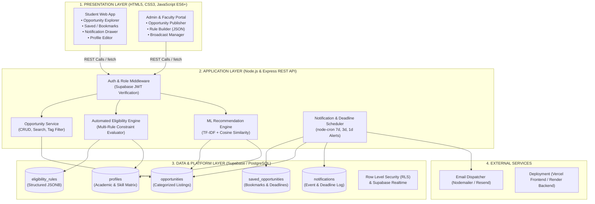
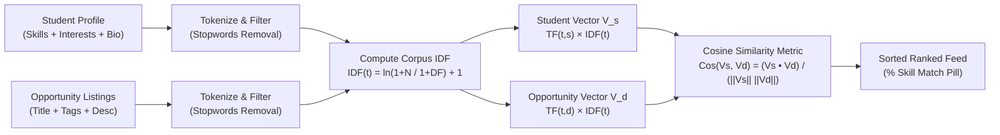
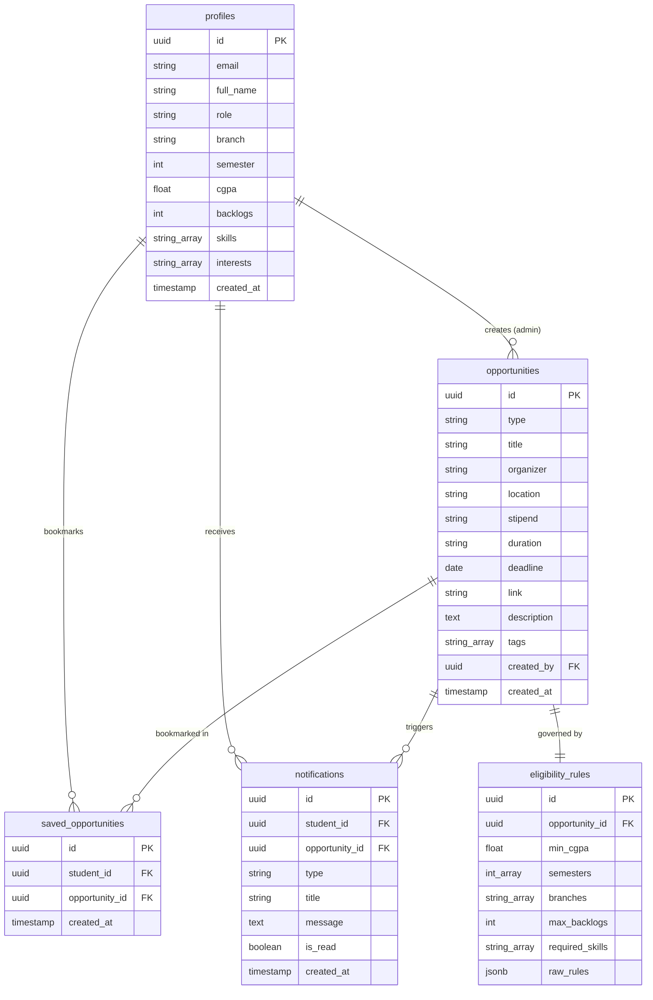
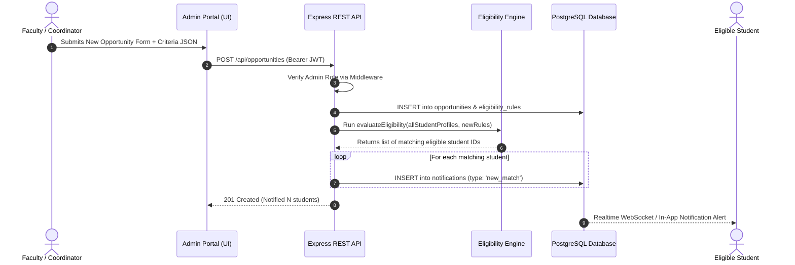
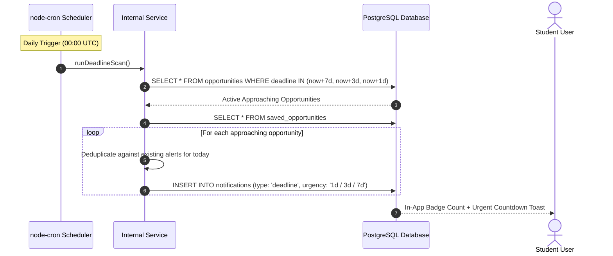

# CampusConnect – Student Opportunities Platform
## Comprehensive System Architecture & Engineering Specification
**REVA University, Bengaluru**  
**School of Computing and Information Technology**  
**Department of Computer Science and Engineering (Artificial Intelligence & Machine Learning)**  
*Semester-End Capstone Project Evaluation*

---

## 1. Executive Summary & Problem Definition

In contemporary engineering campuses like **REVA University**, opportunities across **Internships, Hackathons, Workshops, Certifications, Scholarships, and Part-Time Campus Roles** are distributed across disparate and fragmented channels: WhatsApp groups, unofficial Telegram channels, faculty circular emails, physical department noticeboards, and scattered external aggregators (Devpost, Unstop, Internshala).

### 1.1 The Pain Points
1. **Information Asymmetry & Missed Deadlines**: Students frequently discover competitive hackathons or scholarship portals after the closing deadline.
2. **Eligibility Mismatch**: Students invest hours preparing application materials only to be rejected at initial screening due to branch exclusions, CGPA thresholds (< 7.5), active backlogs, or missing course prerequisites.
3. **Information Overload**: 3rd and 4th-year students are overwhelmed by hundreds of irrelevant notifications that do not align with their technical specializations (e.g., Computer Vision, NLP, Cloud Systems).

### 1.2 The Solution: CampusConnect
**CampusConnect** is a centralized, real-time opportunities platform built with modern **HTML5, CSS3, JavaScript (ES6+), Node.js Express, and Supabase**. It features:
- **Automated Eligibility Engine**: Validates student academic parameters (CGPA, semester, branch, backlogs, technical prerequisites) in real-time with deterministic pass/fail explanations.
- **Content-Based AI Recommender**: Implements **TF-IDF (Term Frequency–Inverse Document Frequency)** and **Cosine Similarity** vector space metrics to rank opportunities against individual student skill trees and interest profiles.
- **Dual Notification Pipeline**:
  - *Event-Driven*: Broadcasts immediate alerts to verified matching students when faculty/admins publish new listings.
  - *Schedule-Driven*: Scheduled daily cron jobs identify deadlines expiring in **7, 3, or 1 days** and trigger persistent in-app and email reminders.

---

## 2. System Architecture

CampusConnect follows a clean **4-Tier Layered Architecture** ensuring separation of concerns, high maintainability, and scalability.

### 2.1 Architectural Tier Breakdown
| Tier | Components | Technical Role |
| :--- | :--- | :--- |
| **Presentation Tier** | Semantic HTML5, CSS3 Custom Properties, Vanilla JavaScript (ES6+ Modules) | Delivers a high-performance, accessible, responsive user interface with zero heavy frontend build overhead, enabling instant loading and developer clarity for lab evaluations. |
| **Application Tier** | Node.js runtime, Express.js framework, CORS, Dotenv | Houses core business logic: REST endpoints, candidate rule evaluation, TF-IDF vector transformations, and cron scheduling. |
| **Data & Platform Tier** | Supabase (PostgreSQL 15), Row Level Security (RLS), Realtime WebSockets | Relational storage for profiles, opportunities, JSONB rule constraints, bookmark states, and audit logs. |
| **External Tier** | SMTP / Nodemailer, Vercel / Render cloud infrastructure | Handles transactional notification emails and cloud application hosting. |

---

## 3. Core Algorithmic Formulations

### 3.1 Automated Multi-Factor Eligibility Engine
The eligibility engine evaluates candidate profile vector $S$ against an opportunity criteria set $R$:

$$S = \langle \text{cgpa}_s, \text{sem}_s, \text{branch}_s, \text{backlogs}_s, \mathbf{K}_s \rangle$$
$$R = \langle \text{cgpa}_{\min}, \mathcal{M}_{\text{sem}}, \mathcal{B}_{\text{branch}}, \text{backlogs}_{\max}, \mathbf{K}_{\text{req}} \rangle$$

The boolean qualification function $\Phi(S, R)$ is formulated as a conjunction of 5 independent predicates:

$$\Phi(S, R) = P_{\text{cgpa}} \land P_{\text{sem}} \land P_{\text{branch}} \land P_{\text{backlog}} \land P_{\text{skills}}$$

Where:
1. **CGPA Condition**: $P_{\text{cgpa}} = (\text{cgpa}_s \ge \text{cgpa}_{\min})$
2. **Semester Condition**: $P_{\text{sem}} = (\text{sem}_s \in \mathcal{M}_{\text{sem}})$
3. **Branch Condition**: $P_{\text{branch}} = (\text{branch}_s \in \mathcal{B}_{\text{branch}}) \lor (\text{"ALL"} \in \mathcal{B}_{\text{branch}})$
4. **Backlog Condition**: $P_{\text{backlog}} = (\text{backlogs}_s \le \text{backlogs}_{\max})$
5. **Technical Prerequisite Condition**: $P_{\text{skills}} = \forall k \in \mathbf{K}_{\text{req}}, \; \exists s \in \mathbf{K}_s \text{ s.t. } \text{Match}(k, s)$

If $\Phi(S, R) = \text{False}$, the engine returns the exact set of unsatisfied predicates:
$$\mathcal{E}_{\text{failed}} = \{ P_i \mid P_i = \text{False} \}$$

---

### 3.2 Content-Based Recommendation Engine (TF-IDF + Cosine Similarity)
To personalize listings for REVA AIML students, opportunities that have passed eligibility are ranked using the **Vector Space Model (VSM)**.

#### Mathematical Equations:
1. **Term Frequency (TF)**:
   $$\text{TF}(t, d) = \frac{f_{t, d}}{\sum_{t' \in d} f_{t', d}}$$
   *Where $f_{t, d}$ is the raw frequency of term $t$ in document $d$.*

2. **Inverse Document Frequency (IDF)**:
   $$\text{IDF}(t, D) = \ln\left(\frac{1 + |D|}{1 + |\{d \in D : t \in d\}|}\right) + 1$$
   *Where $|D|$ is total corpus size, and $|\{d \in D : t \in d\}|$ is the document frequency of term $t$.*

3. **Composite TF-IDF Weight**:
   $$w_{t, d} = \text{TF}(t, d) \times \text{IDF}(t, D)$$

4. **Cosine Similarity**:
   $$\text{Sim}(\mathbf{v}_s, \mathbf{v}_d) = \cos(\theta) = \frac{\mathbf{v}_s \cdot \mathbf{v}_d}{\|\mathbf{v}_s\| \|\mathbf{v}_d\|} = \frac{\sum_{t \in \mathcal{V}} w_{t, s} w_{t, d}}{\sqrt{\sum_{t \in \mathcal{V}} w_{t, s}^2} \sqrt{\sum_{t \in \mathcal{V}} w_{t, d}^2}}$$

---

## 4. Database Schema & Entity Relationships

---

## 5. End-to-End System Workflows

### 5.1 Admin Opportunity Publishing & Automated Notification Pipeline

### 5.2 Scheduled Deadline Alert Cron Routine

---

## 6. Complete REST API Specifications

| Method | Endpoint | Description | Request Body / Parameters | Access Control |
| :--- | :--- | :--- | :--- | :--- |
| `GET` | `/api/opportunities` | Returns all opportunities with optional filter query parameters | `?type=hackathons&search=ai&tag=python` | Student, Admin |
| `GET` | `/api/opportunities/eligible` | Returns exclusively opportunities the authenticated student satisfies | None | Student |
| `GET` | `/api/opportunities/:id/eligibility` | Returns granular pass/fail breakdown of all 5 criteria for an event | Opportunity ID | Student, Admin |
| `GET` | `/api/recommendations` | Returns ranked listings ordered by TF-IDF Cosine Similarity against profile | None | Student |
| `POST` | `/api/opportunities` | Creates new opportunity listing with structured eligibility rules | `{ title, type, organizer, deadline, eligibility_rules: {...} }` | Admin Only |
| `PUT` | `/api/opportunities/:id` | Modifies existing opportunity metadata or criteria | JSON updates | Admin Only |
| `DELETE` | `/api/opportunities/:id` | Deletes opportunity and cascades removal from bookmarks | Opportunity ID | Admin Only |
| `POST` | `/api/saved/:id` | Toggles bookmark status for logged-in student | Opportunity ID | Student |
| `GET` | `/api/saved` | Retrieves all student bookmarked items with remaining day count | None | Student |
| `GET` | `/api/notifications` | Retrieves notification history and unread count | None | Student |
| `PATCH` | `/api/notifications/:id/read` | Marks individual notification as read | Notification ID | Student |
| `POST` | `/api/notifications/read-all` | Marks all active notifications as read | None | Student |
| `GET` | `/api/profile` | Retrieves logged-in user profile, skills, and academic metrics | None | Student, Admin |
| `PUT` | `/api/profile` | Updates student CGPA, semester, skills, and interests | `{ cgpa, semester, skills: [...] }` | Student |
| `POST` | `/api/scheduler/trigger-deadlines` | Simulates and executes daily cron scan for 7, 3, and 1 day deadlines | None | Admin, Evaluation |

---

## 7. Technology Stack Justification

| Technology | Justification for Semester-End Evaluation |
| :--- | :--- |
| **HTML5 & Semantic Elements** | Structured semantic tags (`<header>`, `<nav>`, `<main>`, `<dialog>`, `<article>`, `<aside>`) provide standard-compliant DOM tree architecture and high accessibility score. |
| **CSS3 Design System** | Implemented using CSS Custom Properties (Variables), Flexbox, CSS Grid, Glassmorphism, and responsive media queries without reliance on heavy CSS frameworks. |
| **Vanilla JavaScript (ES6+)** | Native modules, Async/Await, Fetch API, DOM manipulation, custom event listeners, and client-side TF-IDF vector math ensure raw JavaScript mastery. |
| **Node.js & Express.js** | Non-blocking I/O event loop powers the RESTful routing layer and rule execution engine with negligible latency. |
| **PostgreSQL & Supabase** | ACID-compliant relational data modeling with Row Level Security (RLS) guaranteeing strict per-student data privacy. |
| **node-cron** | Emulates daemon background scheduling for automated temporal notifications without manual intervention. |

---

## 8. Viva-Voce Evaluation Guide for REVA University Students

### Q1: What makes CampusConnect different from general portals like LinkedIn or Unstop?
> **Answer**: General job portals show thousands of listings where students must manually check lengthy PDF brochures for eligibility criteria. CampusConnect applies **deterministic constraint-satisfaction checking** right on the student's dashboard. A student never wastes time applying for opportunities where they are disqualified by branch, semester, backlog, or CGPA cutoffs. Furthermore, our content-based **TF-IDF engine** ranks qualified listings to match their specific AIML domain interests.

### Q2: Why did you use TF-IDF and Cosine Similarity rather than simple keyword matching?
> **Answer**: Simple keyword matching treats all words equally. **TF-IDF** assigns mathematical weights: common terms like "engineering" or "program" receive low IDF scores, whereas distinctive domain skills like "PyTorch", "LoRA", "TensorFlow", or "Computer Vision" receive high IDF scores. **Cosine similarity** normalizes document length, ensuring large descriptions don't artificially dominate shorter listings.

### Q3: How do you handle cases where a student has backlogs?
> **Answer**: The eligibility engine checks `student.backlogs <= rules.max_backlogs`. If an opportunity permits 0 backlogs and the student has 1, the rule fails with an exact explanation: `"Requires at most 0 active backlog(s) (You have 1)"`. The listing displays a warning status pill and disables the apply button to prevent false submissions.

### Q4: How is security and data privacy maintained?
> **Answer**: By leveraging Supabase Row Level Security (RLS) and JWT bearer authentication. Students can only query and mutate their own bookmarks, profiles, and notification records. Only accounts with the `admin` role are authorized to access the opportunity mutation endpoints (`POST /api/opportunities`, `PUT`, `DELETE`).

---
*Department of Computer Science and Engineering (AIML), REVA University, Bengaluru*

